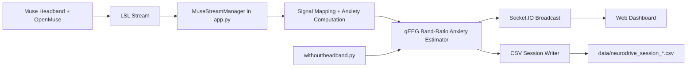

# NeuroDrive System Architecture (Brief)

This document summarizes the architecture of the NeuroDrive final year project for poster preparation.

## 1) Architecture Overview

NeuroDrive is a real-time EEG anxiety monitoring system with a web-first architecture.

- Frontend: browser dashboard (`templates/fypdashboard.html`)
- Backend: Flask + Socket.IO server (`app.py`)
- Data source: Muse EEG stream via LSL (`pylsl`) or simulation mode (`withouttheadband.py`)
- Anxiety estimator: qEEG band-ratio calculator (`utils/anxiety_calculator.py`)
- Storage: session CSV files in `data/`
- Optional artifacts: trained models and reports in `artifacts/`

## 2) Main Runtime Components

1. Dashboard UI (Presentation Layer)
- Renders live metrics: Delta, Theta, Alpha, Gamma, heart rate, anxiety level.
- Sends user controls (start/stop session, export).
- Receives low-latency updates through WebSocket (Socket.IO).

2. Web Application Server (Application Layer)
- Flask routes expose dashboard and REST APIs.
- Socket.IO broadcasts stream status and real-time telemetry.
- Central controller is `MuseStreamManager` in `app.py`.

3. Stream Processing Layer
- Discovers Muse streams using LSL resolver functions.
- Opens stream inlet and samples continuously at target rate (20 Hz).
- Maps channel labels to signals (delta/theta/alpha/beta/gamma/heart).
- Computes a non-clinical anxiety estimate from qEEG band-power relationships instead of trusting a raw incoming anxiety channel.
- Handles reconnect and stale stream detection.

4. Anxiety Estimation Layer
- Uses band-power ratios described in the reference PDF: Theta/Beta Ratio, inverse Alpha/Sum Ratio, and fast-wave dominance.
- Uses beta when available; if beta is unavailable but gamma is present, gamma is marked as a proxy for fast-wave activity.
- Produces an anxiety score from 0-100, a low/medium/high label, calculation method, and diagnostic ratios for CSV traceability.
- Important limitation: this is a research-aligned heuristic estimate, not a clinically validated classifier. A validated model would require raw EEG preprocessing, PSD extraction, artifact rejection, and psychometric ground-truth labels such as STAI/HAM-A.

5. Persistence Layer
- Session data buffered in memory as records.
- CSV exported at session end to `data/neurodrive_session_*.csv`, including anxiety method and ratio columns.
- Historical sessions can be listed and downloaded via API.

6. Simulation/Resilience Layer
- `withouttheadband.py` provides synthetic EEG band metrics when headset is unavailable, then runs those bands through the same qEEG estimator used by the real stream path.
- `connect_muse.py` supports connection checks and fallback behaviors.

## 3) End-to-End Data Flow

## 4) Control Flow (User Interaction)

1. User starts server (`run.py`, `app.py`, or launcher scripts).
2. Dashboard opens at `http://localhost:5000`.
3. User starts a session from the UI.
4. Backend streams EEG telemetry in real time to all connected clients.
5. User stops session.
6. Backend finalizes and saves CSV for analysis/reporting.

## 5) Interfaces and APIs

- UI endpoint: `GET /`
- Session/stream status: `GET /api/status`
- Start stream: `POST /api/start`
- Stop stream: `POST /api/stop`
- List sessions: `GET /api/sessions`
- Read session: `GET /api/session/<filename>`
- Real-time channel: Socket.IO events (`status_update`, `metrics_update`)

## 6) Why This Architecture Fits the Project

- Real-time capable: WebSocket streaming supports low-latency updates.
- Modular: acquisition, processing, visualization, and storage are separated.
- Robust for demos: simulation mode allows operation without hardware.
- Scalable presentation: browser-based UI works across machines without PyQt dependency.

## 7) Suggested Poster Summary (One Paragraph)

NeuroDrive uses a web-based, real-time architecture to estimate anxiety from EEG band-power signals. A Flask + Socket.IO backend acquires Muse data over LSL, maps brainwave features, computes a qEEG band-ratio anxiety estimate using Theta/Beta, Alpha/Sum, and fast-wave dominance indicators, then streams live metrics to a browser dashboard. During each session, records are stored and exported as timestamped CSV files for analysis. The system also includes simulation mode for reliable testing and demonstrations when a physical headset is unavailable.
